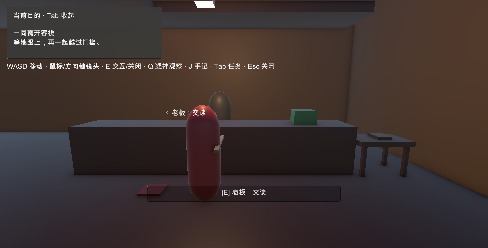

# 2026-11-03｜把“能通关的灰盒”打磨成可以探索的客栈

今天围绕《荒夜客栈》做了几轮“设计讨论 → 实现 → 试玩反馈 → 修正”。重点从打通流程，转向让人物说话自然、调查顺序自由、空间比例可信，并为后续 UI 与美术替换做好准备。

本文根据本工作区当天的剧情、开发、UI、美术与留档对话，以及对应实现文档整理。下面的验证结果来自开发对话记录；本次写作没有重新执行游戏测试。

## 1. 先弄清昨夜发生了什么，再决定玩家调查什么

最初的问题是：虽然目标已经明确——救醒同行者、取得剑、一起离店——但怎样让调查与选择产生实际差异，而不只是换一段结局文字？

讨论从三个人的动机展开：女主想安全完成护送，也有未公开的师门调查；同行者愿意暂时回家，却担心失去决定权；老板想帮助她们，但背负护送活人的旧账。随后厘清改貌药与昏睡毒的不同来源、同行者主动取走手令的经过，以及老板与昨夜客人的冲突，避免用模糊药理替代因果。

这套真相被拆成房间、血迹、药物、手令、旧账与人物证词。玩家可以部分理解事件后离开，不必收齐线索。三种取剑方式与三种离店约定独立，形成九种主要收束组合；八项真相只记录玩家知道多少，不作善恶评分。

**这一步的经验：** 先写作者知道的完整事件，再划分每个人知道和隐瞒的内容，最后把信息放回可调查的物件与对白里。

详见：[剧情与探索设计](../Narrative/客栈Demo_剧情与探索设计交接_v1.md)。

## 2. 试玩暴露了“信息都有，但体验不自然”的问题

第一轮试玩反馈集中在四件事：叙事交代生硬、关闭交互不顺手、地图热点全亮而缺少观察空间、玩家不知道下一步做什么。另外，醒来的同行者跟得太紧。

据此完成了第一轮调整：

- 把眼前所见、女主心想、纸面文书和角色对白分开呈现；昨夜经过通过追问展开。
- E 可以打开和关闭交互，保留关闭按钮与 Esc；镜头增加方向键控制。
- 默认只提示近距离最近的一处热点；Q 临时显示可见范围内的热点 4 秒，避免隔墙、跨楼层提示。
- 当前目的随已知信息更新，Tab 可收起；真相收集不成为任务清单门槛。
- 跟随改为超过 3.2 米才开始、进入 2.2 米内停止，过近时让开。

**这一步的经验：** 调查游戏需要让玩家看见可以行动的方向，同时给场景留下观察空间。提示强度、信息揭露顺序和交互手感要一起调。

## 3. 自由顺序需要状态规则，出口也需要独立处理

下一轮反馈发现：先与同行者商量好约定，再向老板取剑，系统却要求重新商量；而普通跟随的停步距离又可能让同行者停在门内，无法满足双人离店条件。

修正后，取剑对白会承认已有约定，重谈只是可选项。门口则进入短距离汇合与并肩离店，仍要求两人实际跨过门槛才结算。

为了让后续修改更容易追踪，真相、取剑、约定条件及部分情境对白开始移入 JSON 配置，补充事实目录、状态变化与依赖图。主对话树仍在 C# 中，尚未做成完整剧情编辑器。

**这一步的经验：** “玩家达成了什么”与“当前对白怎么说”必须共享状态依据。跟随距离适用于日常移动，不能直接替代出口演出的完成逻辑。

详见：[剧情状态与依赖配置](../Narrative/客栈Demo_剧情状态与依赖配置_v1.1.md)。

## 4. 从两个紧凑房间，调整成有生活感的客栈

开场改为先交代今日要护送上路，再让女主叫旁边床位的同行者，发现空床后下楼找人。昨夜客人的药包、残食与散乱行李明确放在另一间客房，避免空间归属混淆。

随后根据“二楼太紧凑”的反馈扩为五间房、加宽公共走廊：己方双床房与昨夜客人的单床房开放，其余三间关门。这样补足客栈规模感，又控制了解谜内容的制作范围。

另一个直观问题是老板被柜台挡得太多。于是重新以实际尺寸校正占位：女主 1.60 米、同行者 1.70 米、老板 1.75 米，柜台 1.05 米、桌面 0.76 米，床约 1.1 × 2.1 米。

*开场房间的已有实拍：当前目的先指向叫醒同行者。角色与家具仍是灰盒占位。*

## 5. 封顶以后，才能真正检查室内镜头

试玩提出了一个关键问题：如果没有天花板，就无法完整检验室内镜头。客栈因此补上屋顶、调整净高与室内照明；镜头遇墙、门楣或天花板时拉近，离开后平滑恢复，极近时隐藏女主占位网格。

开发记录报告完成了 96 个机位采样及角色通行检查，但“没有检测到穿模”还不能替代舒适度验收。门洞、贴墙转向、上下楼和镜头恢复速度，仍需要实际试玩。

*柜台前的已有实拍：用人物身高校准家具比例，再检查实际视角。*

详见：[场景尺度与室内镜头](../Scene/客栈Demo_场景尺度与室内镜头验收_v1.md)。

## 6. 手记开始图形化，结局需要一眼看懂

UI 反馈希望八项线索有图卡、结算横排徽记、已读对白有颜色提示。实现中加入了图卡与详情、已读选项变色及存档保存；手记第二页按随身与约定、现场与文书、人物证词分区，结局名称改成居中大字。

最后还修复了一个细节：“继续交谈”只是返回话题菜单，却会被统一的已读逻辑染色。现在导航不再记录已读，真正的剧情话题仍保留已读提示。

*手记第二页：物件与约定、现场文书、证词分别组织。*

*“共同决定”结局与横排八项往事徽记。插画及正式视觉仍待制作。*

Figma 工作目前停留在交接与视觉探索规划：先做探索 HUD、交谈、手记三张代表稿，选定方向后再扩展组件与导出素材，尚未接入正式设计。

详见：[UI 设计交接](../UI/客栈Demo_UI设计交接_Figma_v1.md)。

## 7. 开始准备美术替换，但先做小样

当天新开的美术对话明确了下一阶段：沿用现有 Unity 灰盒，用实际机位辅助探索建筑细节，再按模块制作；先尝试床、桌、凳和药箱，验证风格、米制尺寸、材质、枢轴与 Prefab，再批量替换。

已建立美术接入与资产清单，并检查生成、导入服务。当前仍属于规划：没有生成或替换正式模型，没有消耗 Aholo 积分，风格样本尚未批准。角色模型、骨骼与动画另行规划。

## 今天做到哪里

- **可体验：** 开场找人、客房辨毒、救治、取剑、约定、双人离店；调查手记与存读档。
- **开发记录中的验证：** 编译检查、九种收束组合的状态测试、最短对话链、事实去重与存档往返、交互采样、镜头采样。没有把这些等同于九条完整人工走图。
- **仍需打磨：** E/Q/Tab 实际按键、楼梯与转角、跟随绕障、镜头舒适度、对白节奏及目标时长。曾出现 memoryless depth surface 渲染警告。
- **下一步：** 继续完整试玩；确定 UI 视觉方向；完成少量静态道具样板；保持灰盒碰撞、剧情与交互锚点稳定。

今天也完成了首个 GitHub 基线留档。四张图均来自当天已有 Unity 截图，原样精选，不是补造的历史画面。正式美术、动画与音效还没有完成。
