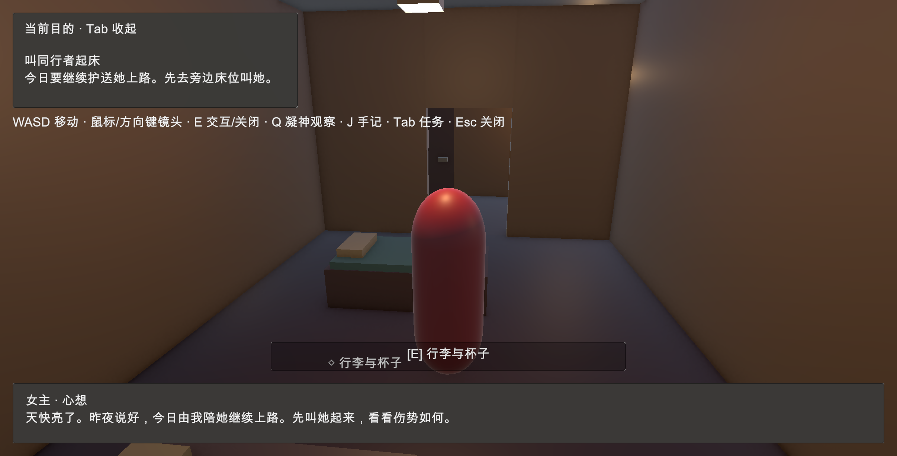
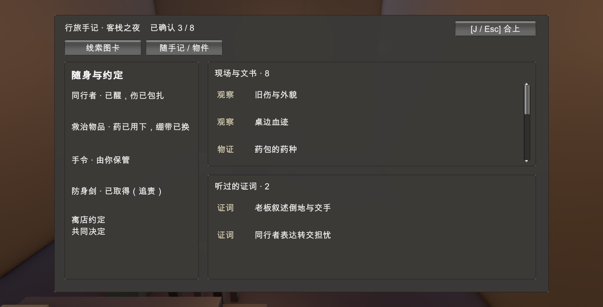
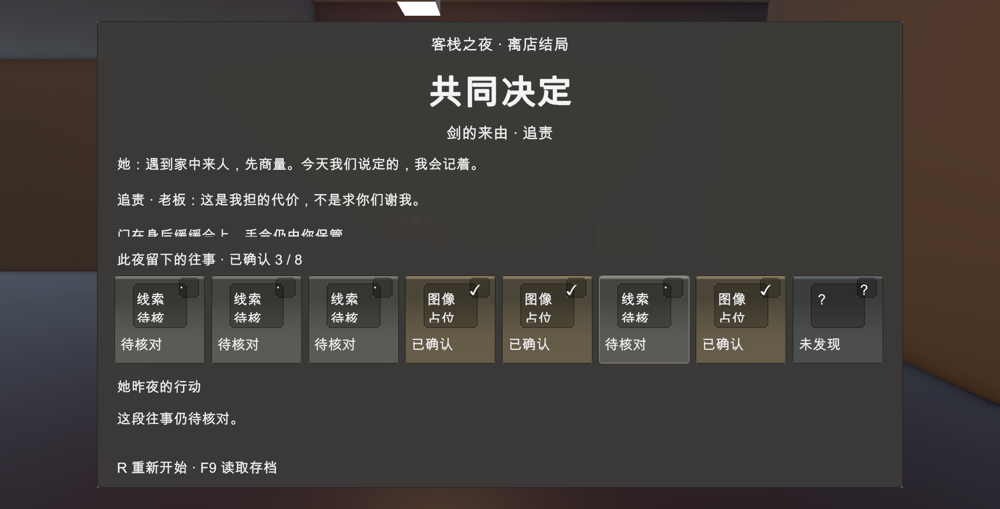

# 2026-11-03 开发记录

日期：Asia/Shanghai。根据当前源码、工程 README、剧情/UI/场景交接文档整理；本次未修改玩法或建模。

## 新增
- 已有实现：五间客房、开场空床调查、图卡手记与分类记录、结局大标题。
- 已有实现：人物 1.60/1.70/1.75m、柜台 1.05m、完整屋顶与肩侧防遮挡镜头。
- 本次：Unity 忽略规则、简短 CHANGELOG、日期日志与四张精选截图。

## 修复
- 原文档记载：取剑保留约定、双人跨门槛离店、旧布局存档位置迁移、继续交谈导航不计已读。
- 本次未修改游戏代码。

## 验证
- 本次阅读现有文档及实现文件目录，逐张查看以下四张已有实际截图；未重新运行编译或完整键鼠试玩。
- 原 README 与场景文档记载规则九组合、存档往返、96 个镜头采样与双人离店检查通过；这些是既有报告，不代表本次重测。
- Assets 共约 7 MiB，无超过 50 MiB 的文件，当前无需 LFS；新增大型模型/贴图前重新评估。

## 已知问题与限制
- 尚需人工验收 E/Q/Tab、完整走图、楼梯与镜头手感、同行者绕障碍；角色、动画、声音和 UI 图像仍有占位。
- 原文档报告 memoryless depth surface 警告。
- Packages/manifest.json 有本机 Tripo file 依赖，归档副本已移除该可选编辑器插件的 manifest/lock 条目，原工程保持不变；仍需验证干净电脑还原；不能据此宣称干净电脑已可还原。
- 已确认远端 https://github.com/JHketsu/wuxia-inn-demo ，初始为空；独立归档仓库为 GitHubArchive，保留原工程配置。

## 精选截图
以下为已有 Unity 实际截图的原样副本，文件修改时间为上海时间 2026-11-03 17:25—17:49；时间来自文件元数据，不作为不可变拍摄证明。不是本次重新拍摄，也不是 11-02 历史画面。

来源：Assets/Screenshots/Scene_EnclosedBedroom.png。

来源：Assets/Screenshots/Scene_FinalScale_Counter.png。

来源：Assets/Screenshots/UI_Notes_FinalProof.png。

来源：Assets/Screenshots/UI_Ending_FinalTitle.png。

## 下一步
- 完成基线提交推送后核对远端；第三方仅含现有 Unity 模板资源及包引用，未纳入模型、StyleLibrary、Tools 或外部生成服务源码。未发现明文凭据，未纳入编辑器布局文件。
- 人工试玩后补充实测结果，首份留档完成后再讨论每日自动整理。

## 证据
- ../../游戏工作区/wuxia/Assets/InnDemo/README.md
- ../Scene/客栈Demo_场景尺度与室内镜头验收_v1.md
- ../Narrative/客栈Demo_剧情状态与依赖配置_v1.1.md
- ../UI/客栈Demo_UI设计交接_Figma_v1.md
