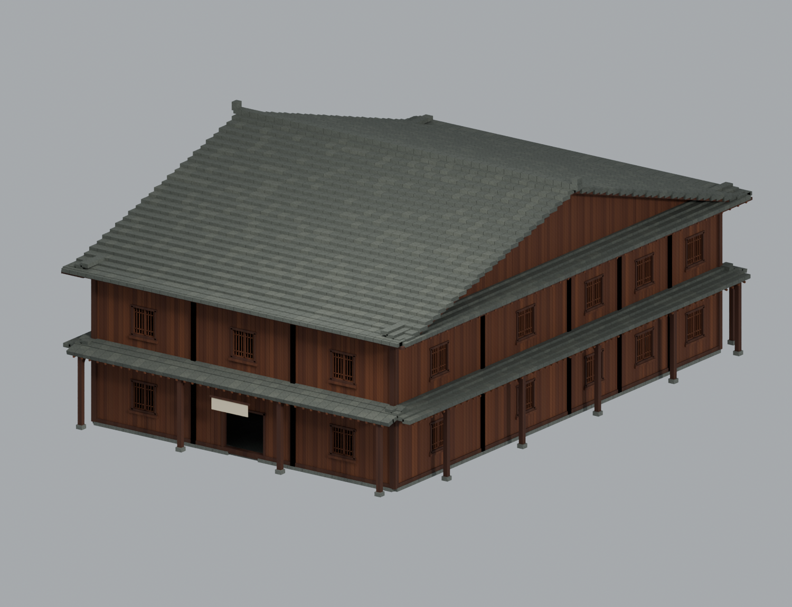
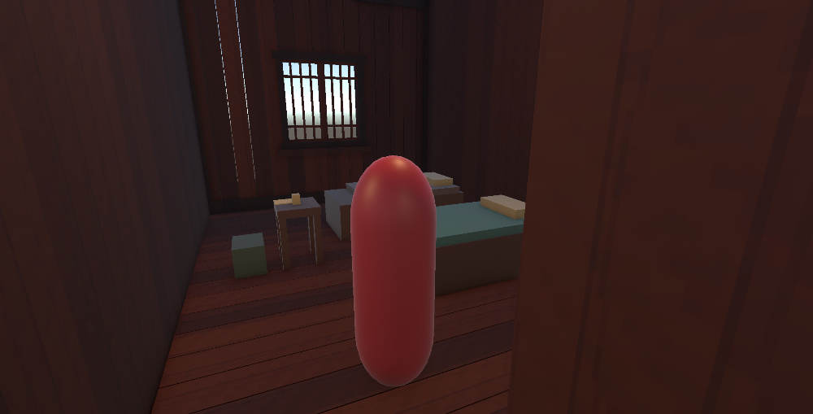
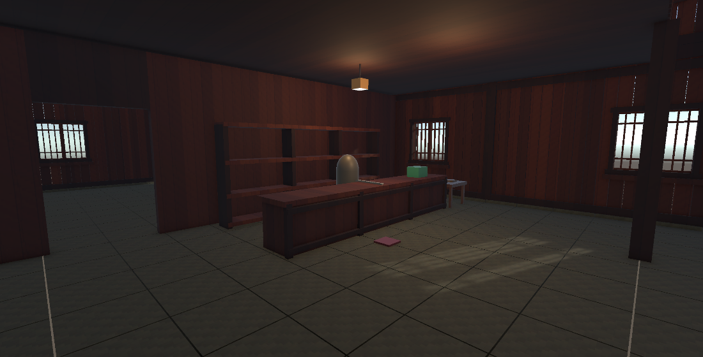
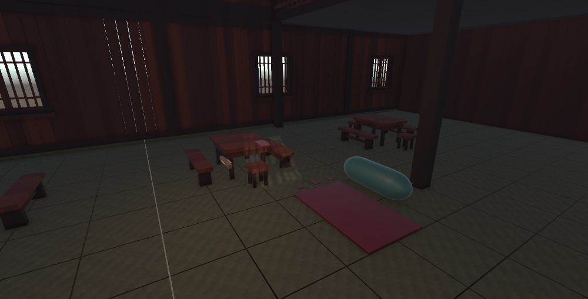

# 2026-11-04｜从 AI 建筑参考图，到可以走进去的木构客栈

本篇接续昨天日志完成后的更新，包含昨晚继续推进的美术探索，以及今天的建筑重建、玩法整合与音乐讨论。昨天还主要是灰盒，今天已经有了木墙、层叠瓦檐、双扇格窗、楼梯栏杆和成套桌凳，并将建筑素材接入游戏流程。

## 1. 美术方向：先纠正“太现代”，再统一建筑语言

接手美术后，最重要的反馈是建筑偏现代、缺少古意。用户重新选定古朴木构参考，要求全木墙身、粗梁柱、厚重块瓦、窄竖格窗、深挑雨檐和落地支柱，排除大片玻璃和薄钢片感屋面。细体素块面保留，但需要有明确的三维体积。

工作从参考图与提示词迭代开始：先清理外观图中的陈设和背景，再补齐立面与室内空间说明。一层窗户改为与二层同款，正门以外的外墙开间补窗。室内参考进一步确定木板顶、梁架、灰石一楼与木地板二楼。

**经验：** “古朴”需要拆成可检查的材料和构造特征。只在提示词里加风格词，难以约束窗型、瓦片厚度和檐口结构。

## 2. AI 图纸的多轮纠错：好看不代表空间一致

布局从五房调整为左右各三间的六客房，中央长廊，右侧直梯上楼后左转接横廊，临空处加栏杆。一楼后部保留服务空间，解释建筑纵深，但不展开后厨玩法。

这一轮暴露出几个很适合保留作教程的错误：

| 反馈或发现 | 修订方法 |
| --- | --- |
| 平面有六间房，纵剖却只画出一间 | 明确剖切位置，要求对应东侧连续三间房，并给出各段坐标 |
| 双坡屋顶是否对称不明确 | 用20×30m墙线和Z=5屋脊中点约束，两坡水平投影各15m、等坡等挑檐 |
| 后厨标注抢走主要信息 | 后部改为浅灰服务空间，只保留简短说明 |
| 室内剖切图标签挡住建筑 | 仅移除图6内部文字和白框，保留图外标题与其他面板 |
| 过程稿v3至v6容易与正式版本混淆 | 将确认的外观与平面剖面配对归档为正式方案v2，过程稿保留 |

图像编辑采用“保留其余面板，只修改指定区域”的方式，仍需逐轮核对。AI 图不是精确施工图，模型尺寸以坐标和工程检查为准。

## 3. 从图像生成到可编辑模型：中间还需要结构化建模

本轮实际采用的是“AI参考图 → AI协助编写Blender Python → Blender建模与渲染 → Unity层级和Prefab”，没有证据表明调用了Aholo或Tripo的一键3D生成；现有记录明确未消耗Aholo比赛积分。

早期外皮预览曾修复重复180°旋转与导入轴向问题，并在Play中保留灰盒碰撞。那次室内验收因退出Play及MCP连接中断没有完成，不能把外观成功截图当作完整验收。

今天进一步重建v2，不只做外墙：六客房、四套桌凳、柜台与置物架、直梯、横廊及栏杆一起组织。桌凳按套结组，单件仍可移动；双扇窗分别保留铰接边枢轴；建筑按结构拆组，便于Unity里调整。

建模过程中，用户指出两个具体偏差：二层侧檐缺少连续堆叠的瓦片，每个窗洞应当有左右两扇窗。随后build002补双扇窗与搭接，build003继续补东西侧檐并修正主坡瓦片重合，改成有高差的台阶式排瓦，避免闪面。记录中的导入检查覆盖六客房、四套家具、31组双扇窗与单位缩放层级。

*Blender build003渲染，来源：Docs/Art/Previews/Inn_v2/Exterior_v2_build003.png。这是模型效果预览，不是Unity游戏截图；材质细节还未达到概念图品质。*

## 4. 素材场景做好后，重新安排玩法位置

用户随后要求把独立建筑合到游戏里。新建可玩场景 `InnPlayable_v2`，保留素材预览和旧灰盒。人物、证物与15个交互点重新布置到新结构中：女主住西侧中间双床房，昨夜客人在西侧靠楼梯房，其余四间关闭；老板、剑、药箱、旧账围绕新柜台安排，血痕和手令线索对应实际餐桌。

替代掉的灰盒墙体、楼梯与家具停用，避免视觉结构和碰撞叠加。新布局也更新存档迁移：保留剧情状态，把人物与未取得的剑放回当前布局的安全位置。

*Unity Play定位相机实拍，不含HUD；床、角色与部分剧情小物仍为占位。*

*新柜台、背架与老板位置。木构外观已经落地，但室内亮度和窗边表现还需试玩判断。*

*餐桌、血迹与同行者的位置，展示新家具与剧情锚点如何对应。三张Unity图均来自Assets/Screenshots下同名文件，为已有实际画面，本次原样精选。*

## 5. 音乐开始围绕“信任”讨论

新开的音乐讨论明确：悬疑是表层，核心是云耿耿与萧罗音各有秘密、仍愿意彼此承担，老板也面对曾经错误交付他人的责任。

方案收敛到先做探索曲《未明》和关系主题《同行》，把较完整的情感释放留给真正共同离店。自由调查不能绑成固定音乐时间线；音乐也不应提前把老板标为反派，或用获得装备的胜利音效统一处理托付、追责、夺剑。

音乐对话还讨论了GarageBand与中国乐器音源的尝试路线。目前没有生成、编曲完成或游戏接入的证据，仍属于制作准备。

## AI 使用过程怎样复现

- 图像生成与编辑：美术对话中有多轮实际生成记录，主要输入是用户参考图、当前方案图及精确局部修改要求。图纸反复修订的原因见上表。
- 建模：Blender脚本保留在工作区 `ArtSource/Architecture/Inn_v2/build001` 至 `build003`；正式概念图在 `ArtSource/Architecture/Design/v2`；早期图在 `StyleLibrary/05_GeneratedTrials`。
- 提示词规格见[建筑拆块与生成Prompt](../Art/客栈建筑_拆块与生成Prompt_v1.md)与[外观修订记录](../Art/客栈外观改版_v2_2026-11-04.md)。具体图像模型版本、种子与单次费用未在所读记录中明确，不补猜。
- 本轮可复用的方法是：参考与尺寸约束分开保存；图纸修订与模型构建分别编号；用用户反馈逐项验证，再在实际机位里检查视觉与交互。

## 今天做到哪里，下一步看什么

整合记录报告：编译错误0；96组镜头采样、15个交互站位采样、角色上下楼与通行、测试状态下双人离店，以及原剧情组合与存档回归通过。这些是开发对话与文档中的检查结果，本次整理没有重跑测试，也没有宣称已人工从开场完整键鼠通关。

仍需体验新布局下的探索提示、家具绕行、室内明暗、镜头舒适度；人物胶囊、床和部分剧情道具继续占位，木纹磨损、装饰与正式角色还需迭代。曾出现memoryless depth警告。下一轮优先完整试玩，再按相同机位记录材质、光照和道具替换前后的变化。

[建筑玩法整合与验证细节](../Scene/客栈Demo_建筑v2玩法整合_2026-11-04.md) · [返回项目主页](../../README.md)
