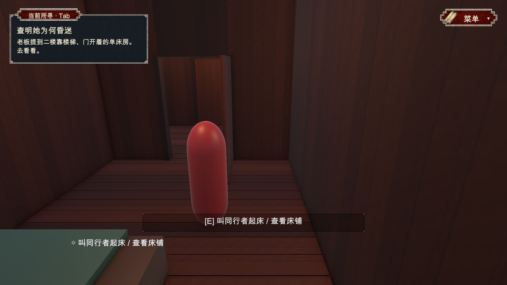
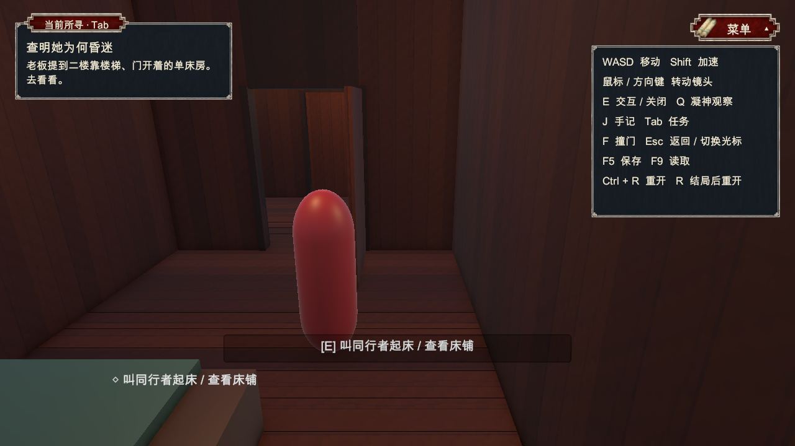
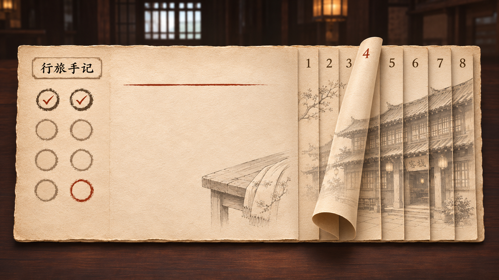

# 2026-11-05｜千禧江湖 HUD 落地，行旅手记试做龙鳞装

上一篇记录了木构客栈接入玩法。这一轮把视觉迭代推进到玩家每次探索和交谈都会看到的界面。探索 HUD 和对白框已接入 `InnPlayable_v2`，手记则确定了下一轮原型方向。

## 从合成效果图拆出可用的界面素材

设计借用客栈窗棂的折角做墨蓝银边大框，用暗朱红阶梯切角做姓名牌和菜单按钮。右上角的图标改用两端向内卷的双卷轴，正文左排，角色胸像无框融入右侧。女主胸像选用带细银链和红色中线的 v2，同行者选用 Merged 版。

AI 辅助视觉探索产出了合成预览和分开的素材。交接时把大框、姓名牌、淡墨山水角纹、双卷轴、胸像与暖黄色小三角分别交给 Unity。文字由引擎排版，框图需要拉伸时应先核对透明留白和切片边界。当前记录可查到选用版本和设计取舍，具体生成模型、种子和费用未核实。

没有等待 Figma 组装即可用现有 PNG 搭出首版。关键是把视觉参考与可单独布局的素材一起交接，并提前用长对白和小分辨率约束画面。详见[设计原则](../UI/千禧江湖_UI设计原则.md)。

## 在游戏里调整可读性

左上任务显示当前目标和下一步，Tab 可收起。右上菜单默认合拢，后续根据试玩反馈补上 M 键与界面提示。对话选项移到画面中央，最终使用透明面板排列红色选项，较长的选项列表仍可滚动。菜单展开时黄色三角向上旋转，底部三角则在正文显示完、可以继续时出现，等待选择时隐藏。

靠近物件时原来有两处交互提示，中下方的重复提示会遮住视线。本轮移除了这处提示，保留物件旁的提示和 E 键交互。

以上两张是首轮 HUD 接入的 Unity 实拍。中央透明选项面板已在 Play 中验证，最新版截图待补。

## 手记从两页收敛为一件可翻动的卷子

手记概念保留八条线索。左侧八枚印记与右侧八条竖直纸边指向同一组内容，中间显示选中线索。原「随手记／物件」暂时并入线索详情，物证和证词随对应线索阅读。

AI 示意图帮助试了“从一跳到四”的构图，但第四叶看起来像一根卷起的窄纸条。下一轮应验证整张纸沿错开的粘边弯起，纸边只露出整叶的一部分。八个导航位置在游戏中保持可点，正文独立排版。先用灰模试打开与跳页两个动作，确认纸张结构和读字体验，再投入整套美术。

这张是改成八条竖直纸边后的概念图。第四叶仍像卷起的窄条，整张书叶的翻动留待灰模验证。

## 验证与下一步

开发记录报告在 1920×1080 和 1280×720 下检查了纯探索、菜单展开和两位角色对话，并验证长对白换行、胸像裁切、选项回调。后续也在 Play 中检查了三角显示条件和透明选项面板。此处汇总已有结果，本次整理未重新运行 Unity。下一轮可补拍最后一版 HUD，并开始龙鳞装手记的翻页灰模。
