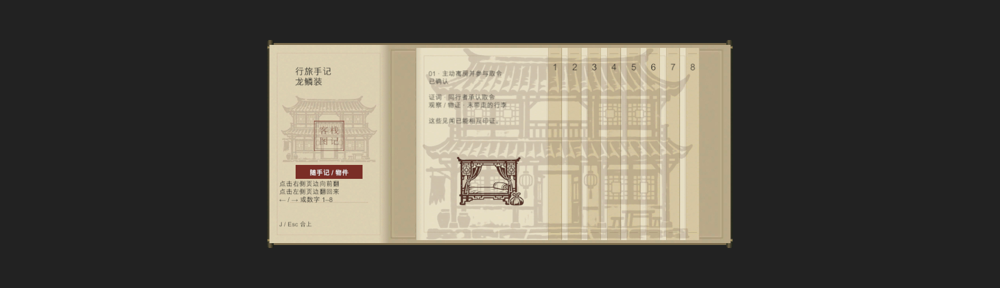
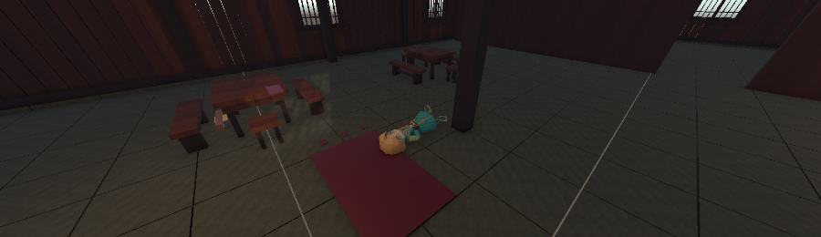
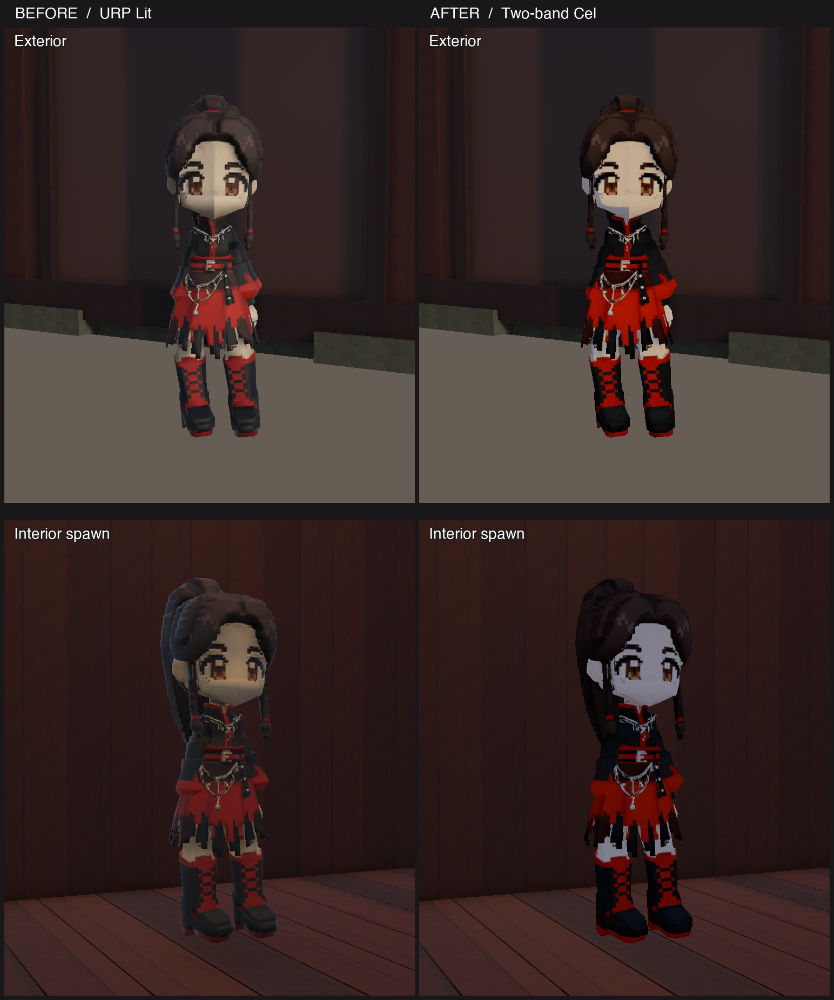

# 2026-11-13｜龙鳞装手记、角色入场与两段明暗试验

本篇补记 11 月 5 日之后至今天尚未写进开发日志的进展。上一期的卷册还在讨论怎么翻，这一轮已能在客栈主场景打开手记。与此同时，角色陆续替换占位模型，剧本文案也有了独立的编辑入口。

## 龙鳞装从概念图变成可操作的手记

早期生成图帮忙找到了「八道纸边拼成客栈」的构图，但把第四叶画成了窄纸条。Unity 原型改用八张完整纸叶，各自沿固定边弯起，翻过去露出纸背。AI 辅助视觉探索确定了暖棕、木刻与镂空留白的方向，后续以灰模尺寸约束素材交付。

Figma 交付把装帧、固定页、印章、纸叶正反面和八张线索插画分开。跨页图再补齐八张 728 × 960 的完整正面，母图宽 1414 px，对应 2× 导出时每叶错开 98 px。设计稿上的错口为 49 px，页签可见带为 34 px，两者混用会造成屋檐和窗棂跳接。用原型核对整页纹理和静止时的拼图，再接入剧情数据。图像生成模型、种子和单次费用未核实。

独立预览验证了第 1 叶跳到第 4 叶，以及插画从 Clue01 切到 Clue04。主场景按 J 打开，右侧纸边前翻，左侧露边翻回。「随手记／物件」保留原记录入口。未发现的线索隐藏标题和插画，待核对时显示已有证据，确认后显示完整结论及插画。开发会话在主场景验证了第 1 叶的状态变化与记录页切换，其余七叶仍待逐条走剧情。

[手记视觉交接](../UI/龙鳞装手记_视觉交接.md)

## 人物开始替换占位模型

云耿耿与萧罗音的 Tripo 原始 FBX 保留在工作区，Unity 使用各自导入的角色资源。云耿耿按实际速度切换待机、走路、跑步。萧罗音在大堂使用昏迷躺姿，救醒后切换到站立，跟随时播放走路。Play 验证了三档移动和躺姿转站立，独立起身动作、楼梯脚步贴合及马尾摆动仍在后续范围。

老板和带流苏的剑也已导入，场景启动时 Console 无报错。取剑后佩挂的位置还待实玩，完整键鼠通关尚未完成。

## AI 道具管线分开记录参考图、预检和实际产出

Tripo 批次规划覆盖外景、植被、解谜关键件和兵器。药箱、剑鞘、账本曾按 Tripo P1、2,000 三角面上限、PBR 贴图做本地预检。设备授权服务连接失败，该批次没有提交或扣点，预算属于估算。已导入的角色资源与这次未提交的道具批次是不同工作。

Lux3D 方向已准备单人床榻、粗陶饭碗、竹筷、床边药渍杯和小陶药瓶五张参考主图。床榻从原画中的模糊低平台整理为一件包含薄席、叠被和枕头的独立道具。四视图及 3D 生成等待主图确认。已有网格需要压到 10K 以下时，讨论的路线是保留 GLB 原模，再到 Blender 做减面和贴图处理。

[Tripo 批次与提示词](../Art/Tripo_外景解谜与兵器批次.md)

## 文案迁到 Yarn，老板话题可以在节点图里查看

玩家可见的对白、调查、文书、任务提示、手记和结局迁到 InnDialogue。Boss.yarn 拆成一个入口和八个话题，StoryText.yarn 按开场、救治、手令、离店等拆成十个节点，保留用户已改的台词和原有行 ID。其余剧情触发与动作继续由 Unity 控制，英文目前覆盖老板的话题菜单与回答。

开发记录中，迁移阶段曾核对 315 项文案、15 个交互点、老板对话 HUD 与原剧情回归。最后一次拆节点通过 Yarn 编译及八条跳转检查，拆分后的场景还待复测。

## 今天的材质试验

在 Unity 6 / URP 17.0.4 的客栈实景里，给云耿耿临时换上两段明暗原型，在室外和室内出生点各拍同机位对照。室外下颌和服装的明暗块更清楚，像素纹样仍可读。室内脸偏冷，头发更容易融进深色木墙。正常游戏仍用原 URP Lit。下一次重点看暖灰暗部、门槛过渡与窗格投影，再决定是否替换角色材质。

四张图来自对应开发阶段的 Unity 实拍和同机位材质对照。本次整理复核了现有产出与开发记录，未重跑 Unity。下一轮优先完整试玩，覆盖手记解锁、剧本跳转、楼梯通行和取剑后的佩挂。
