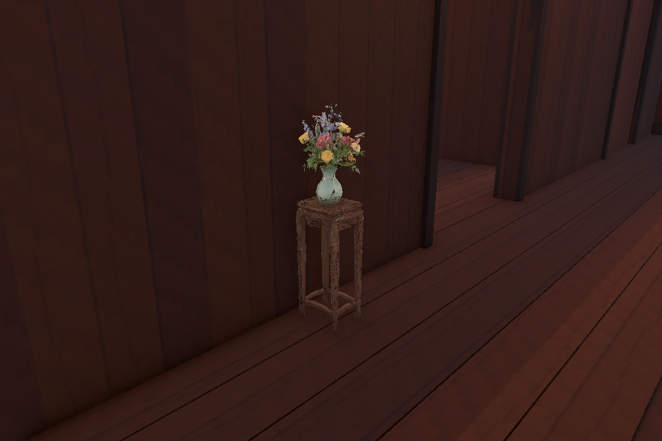
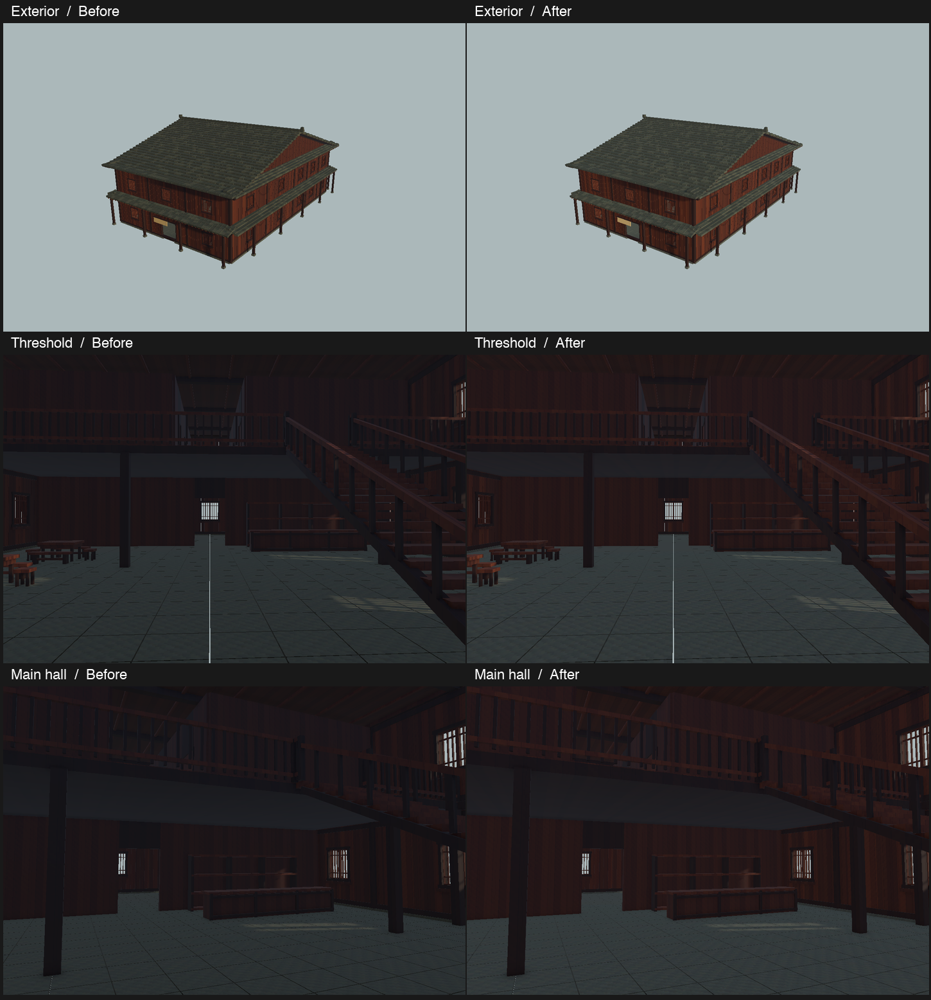
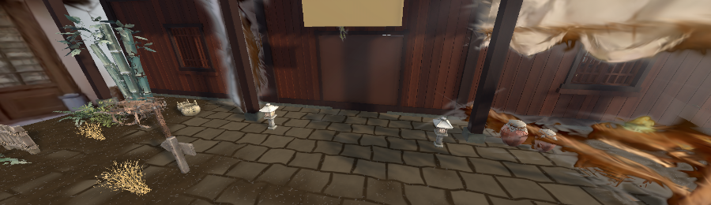
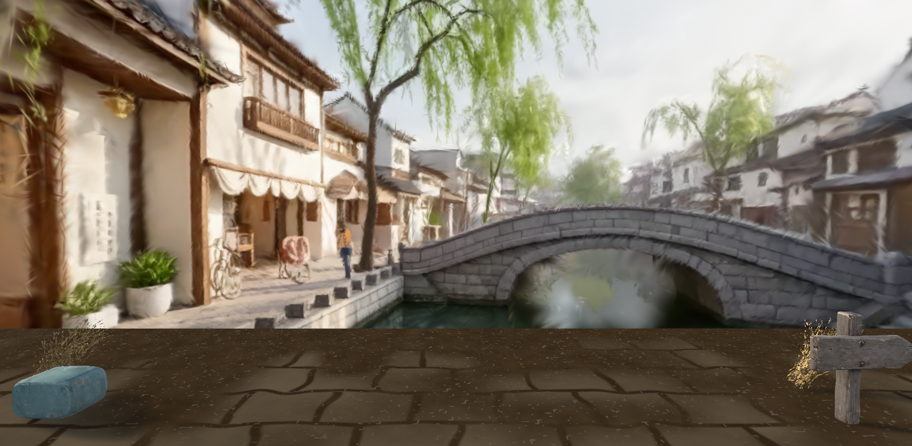

# 2026-11-19｜AI 道具进入客栈，外景和 Web 试玩开始磨合

本篇接续 11 月 13 日，补记这段时间的道具生成与实测、场景陈设、光照、英文切换和 Web 适配。工作从单件模型的观感推进到整间客栈的可读性，以及玩家走出门时看到的环境。

## Aholo 生成之后，先量清模型有多重

这批源资产实测共 52 件 GLB，约 907.60 MiB、1,398 万三角面，涵盖解谜物件、外景、植被、兵器和室内陈设。这个数字来自文件结构审计，代表源资产规模。每件带三张 2K PNG，但材质只引用其中两张，整理未引用贴图也是优化的一部分。

生成反馈开始落到具体比例。花几从较宽版本改成约 90 厘米高、29 厘米见方的瘦高型，深栗木几上放青釉瓶与多色花。Aholo 任务 8208817 的报价为 20 积分，GLB 已下载。源模型约 41.4 万面、25.71 MiB，花、瓶、几合在一个 primitive 中，后期编辑要考虑拆分成本。两版花几都保留了来源，选用瘦高版放入二楼过道。

资产预算按近景交互与空间陈设确定，药箱要保住箱口和扣件，手令要保字纹，花几要保细腿和花枝剪影。规则几何可以重建，复杂轮廓先试减面与贴图整理，再回到实际机位验收。当前审计文档给出了逐件源数据和试做目标，优化后的面数与性能仍需以最终导入件和 Unity 实测补齐。

这张记录了模型放进木构走廊后的实际比例与细节密度。具体生成模型版本、种子及全批次实际总消耗尚未核实。

[源资产实测与优化预算](../AssetPipeline/客栈道具_GLB实测与优化预算_2026-11-17.md)

## 陈设与角色动作一起调整

老板背后的三层货架加入 39 件瓶罐茶具，柜台放算盘和账本。大堂补桌椅、碗筷、酒坛，花架后来移到南侧窗下。十八般武器和展示架曾参与置景，随后从客栈撤出，模型留作备用，老板的剧情用剑保留在柜台。

移动也根据体验调整。WASD 改为默认跑动，起步和停步经过走路动画。跑速随后从 5 降到 4.1，动作节奏相应放慢。开发对话报告在 Play 中检查了按键与松键的过渡。

## 两段明暗应用到三名角色，晨光做同机位比较

上一期还是云耿耿的临时材质试验，这轮云耿耿、萧罗音与老板都在正式场景加载两段明暗 shader。建筑和道具使用 URP Lit。晨光调整抬高了环境补光，让二楼栏杆、踏步与墙板更容易分辨，之后角色暗部从冷灰蓝改为暖棕。

图中三组分别为外观、门槛和大堂，属于这段时间的试调过程。补光抬高后整体反差较柔和，柜台和背墙仍较接近。用户决定先保留当时的明暗效果。期间还修正角色 shader 的投影和深度通道，使各通道共用材质定义，后续 Play 检查无错误。

## 高斯外景接到门外，接缝成为下一轮问题

江南古镇高斯素材提供了河岸、店面与石桥。先在独立场景试摆，再从门槛、院中和高空检查。高斯保留自身光色，客栈和近景道具响应 Unity 光照，两者的衔接需要逐机位调整。

门前从灰色平板改成 Noise 程序材质，近门为暖灰褐旧石板，往外增加泥土和碎石变化。植被校正尺度，两侧补灌丛、蕨类与枯草，中央留出通行位置。

现有实拍仍能看见铺地的方形硬边，以及与高斯河岸之间的直线接缝。高空视角还暴露外景边缘的模糊和缺失。下一轮要在玩家真实出门视角处理轮廓、地面颜色与遮挡。

[高斯摆放方案](../Scene/客栈Demo_外景高斯摆放方案.md)

## 英文与 Web 适配暴露了编辑器之外的问题

本地化对话推进了中英文切换，并测试老板对白。随后在 Web 版本反馈中发现中文依赖本机字体、楼梯碰撞依赖不可读网格两处问题。

项目加入 Noto 中文字体，使 HUD、手记和结局随游戏加载字形。建筑网格开启 Read/Write，供运行时生成碰撞使用，同时增加网格内存占用。Play 检查确认楼梯生成 7 个碰撞体、中文字体正常加载、控制台无错误。修复后的 Web 包仍需重新 Build 并在浏览器验收。

这段时间也整理了 Aholo 提交报告，并在另一个对话推送了 Pages 报告目录。线上部署结果尚待核对。角色表情改造则停留在手工 Q 版头部、贴图五官与工时讨论阶段。

## 下一轮验证

优先重新构建 Web，检查中文、语言切换和楼梯。再完整走一遍救治、取剑与离店，检查新增摆件是否妨碍调查和移动。美术侧继续按相同机位比较门外接缝、柜台辨识度与角色背光效果。

本篇四张图均为已有 Unity 预览实拍或同机位对照，来自上述各阶段。原放在 Library 的两张已复制进日期归档目录。本次整理没有重跑 Unity 或浏览器测试。
