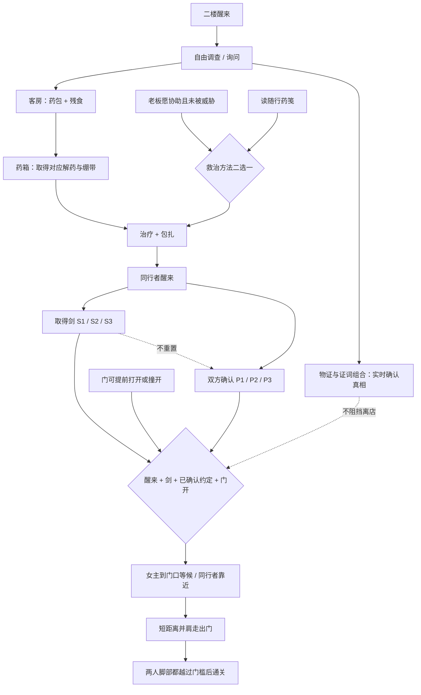

# 客栈 Demo：剧情状态、依赖与配置维护 v1.1

日期：2026-11-03。本文描述当前实现，叙事真相仍以《客栈Demo_剧情与探索设计交接_v1.md》为准。快捷键不变。

## 1. 用什么模型维护剧情

采用“事实集合 + 独立进度状态 + 条件规则 + 情境对白”的模型，不用单一线性任务编号推进整个故事。

- 事实：已观察的物证、已读的文书、听过的证词，按 ID 去重。获得事实一般不撤回。
- 进度：醒否、解药、包扎、剑归属、门、通关。
- 行为：指控、修正、威胁、是否征询、手令归还/代管、谁协助救治。
- 收束：SwordOutcome 和 DeparturePact 相互独立。取剑不清空约定；读新证据也不自动改写已确认约定。
- 知识：从事实集合实时重算真相，因此先证词后证据与反过来相同。真相不作为出门门槛。
- 呈现：同一个交互点根据当前状态选择不同开场与回应。已达成的事可以重谈，但不能被文案误报为“必须再做”。

## 2. 文件与配置边界

| 文件 | 职责 |
|---|---|
| Assets/InnDemo/Resources/InnNarrativeRules.json | 事实目录、真相条件、取剑与约定条件、取剑后/约定开场的对白变体 |
| InnNarrativeRules.cs | 读取 JSON、评估条件、按优先级选对白 |
| InnStoryState.cs | 存档状态、事实去重、规则查询 |
| InnDemo.Story.cs | 主对话树、选择效果、治疗动作、存读档 |
| InnDemo.Guidance.cs | 按当前状态给温和任务提示；探索显隐 |
| InnDemo.GuestRoom.cs | 客房物体、额外调查点、交互状态差异记录 |
| InnDemo.Departure.cs | 门口汇合与双人跨线离店动作 |
| Editor/InnNarrativeValidation.cs | 规则、顺序、存档回归；调试快照 |

**已经配置化的是条件和部分情境对白，不是完整可视化剧情编辑器。** 治疗、跟随、场景生成等动作仍用 C# 执行。主对话节点仍在 Story.cs。后续迁移应一次迁一个话题，保留相同行为与验收，避免同时重写所有对白和进度系统。

## 3. 核心依赖图



治疗的精确条件：antidote + poison +（help 且未 threatened，或 medicineNote）。主线无须手令、旧账或全真相。P1 与 S3 是无额外真相门槛的兜底路线。

## 4. 事实目录：每个信息从哪里来

| ID | 含义 | 产出点 | 类型 |
|---|---|---|---|
| `luggage` | 未带走的行李 | E01 | observation |
| `cup` | 杯沿药渍 | E01 | evidence |
| `medicineNote` | 随行药笺 | E06/二楼 | document |
| `wound` | 旧伤与外貌 | E02 | observation |
| `blood` | 桌边血迹 | E03 | observation |
| `orderFound` | 找到手令 | E03 | evidence |
| `orderRead` | 读过手令 | E03 | document |
| `hand` | 手伤与柜台血滴 | E04 | observation |
| `poison` | 药包的药种 | E05 | evidence |
| `meal` | 残食粉末 | E05 | evidence |
| `guestRoomSearched` | 被翻动的客房行李 | E05 | observation |
| `medicineLabels` | 药箱标签 | E06 | observation |
| `ledger` | 镖号与旧账 | E07 | document |
| `help` | 老板提出救治协助 | E08/老板 | testimony |
| `incident` | 老板叙述倒地与交手 | E08/老板 | testimony |
| `bossTiming` | 老板叙述饭后售药 | E08/老板 | testimony |
| `past` | 老板承认活人镖旧事 | E08/老板 | testimony |
| `wakeConversation` | 已进入醒后对话 | E08/同行者 | presentation |
| `admission` | 同行者承认取令 | E08/同行者 | testimony |
| `appearanceConsent` | 同行者确认自愿改貌 | E08/同行者 | testimony |
| `companionTiming` | 同行者叙述昨夜顺序 | E08/同行者 | testimony |
| `signature` | 同行者识别手令 | E08/同行者 | testimony |
| `concern` | 同行者表达转交担忧 | E08/同行者 | testimony |
| `treatment` | 救治完成 | E02 | event |
| `timing` | 两份时间证词已齐 | derived | derived |

E01 己方房间；E02 同行者；E03 血迹与桌底；E04 柜台血滴/手伤；E05 客房；E06 药箱/药笺；E07 剑与旧账；E08 人物对话。客房的行李只是辅助观察，不新增真相门槛。

## 5. 八项真相怎样确认

以下 `all` 都是 AND；存疑 `any` 是 OR。重复来源不加分。

| ID | 已确认时的表述 | 确认要求 all | 存疑来源 any |
|---|---|---|---|
| T01 | 主动离房并参与取令 | admission | luggage / blood |
| T02 | 知情请求并服用改貌药 | appearanceConsent | cup / wound / medicineNote |
| T03 | 客人先下昏睡毒，改貌药并非主因 | poison + meal + bossTiming + companionTiming | poison / wound |
| T04 | 桌边血来自同行者旧伤 | wound + blood + incident | blood / wound |
| T05 | 老板曾拒绝交人并拦截客人 | hand + incident | hand |
| T06 | 手令来自家中渠道，要求接管 | orderRead + signature | orderFound |
| T07 | 隐瞒是担心被转交 | concern | admission |
| T08 | 老板曾强送活人，后来放人结怨 | ledger + past | ledger |

## 6. 取剑与约定的精确门槛

| 路线 | 必须满足 |
|---|---|
| S1 | awake + !sword + past + consent |
| S2 | awake + !sword + ledger + incident |
| S3 | awake + !sword |
| P1 | awake |
| P2 | awake + concern |
| P3 | awake + orderRead |

`!sword` 表示尚未取得剑。`pactAgreed` 表示 pact > 0；`swordS3` 表示夺取。JSON 里的普通信息 ID 查询事实集合，特殊进度条件由 InnStoryState.Condition 解释。

S1 托付、S2 追责、S3 夺取。P1 亲自履约、P2 共同决定、P3 暂缓交付。两者独立；九种组合都允许。修改任何一方规则后必须运行九组合回归，不能无意将另一方锁掉。

## 7. 关键动作的状态变更及对白后果

| 动作 | 写入 | 不该改变 | 呈现变化 |
|---|---|---|---|
| 求助老板 | help | 不确认谁下毒 | 给客房线索，未威胁时可协助 |
| 威胁老板 | threatened | 不锁药箱、不锁独自救治 | 不再主动协助救治 |
| 指控 / 修正 | accused / corrected | 不篡改事实集合 | 对方回应与修正机会变化 |
| 辨毒 | poison + meal | 不直接确认 T03 | 可取对应解药 |
| 取解药 | antidote | 不自动救醒 | 治疗选项出现 |
| 治疗 | awake + bandaged + treatment + assisted | 不改 pact / sword | 切换醒后对话与跟随 |
| 找到手令 | orderFound + orderOwned | 不等于读过 | 开放阅读 |
| 读手令 | orderRead | 不自动识别真伪、不等于同意转交 | 可请她辨认，开放 P3 提案 |
| 她辨认手令 | signature + admission + concern | 不证明家庭阴谋 | T06/T07 可确认，开放相关对话 |
| 归还手令 | orderOwned=false, orderReturned=true | 不删除已读事实 | 手令物件归属、临别修饰变化 |
| 征询代管 | consent=true | 不改变护送约定 | 允许同意后的代管回应 |
| 接剑 | sword=true, swordOutcome=S | **绝不清空 pact** | 读取 afterSword 配置；已有约定则承认它 |
| 双方确认约定 | pact=P | 不改剑的来由 | 首次确认变成可选重谈 |
| 开门 / 撞门 | opened / broken | 不直接通关、不取消约定 | 缺什么只提示什么 |
| 完成离店 | won | 不计算善恶 | 两段收束 + 已知状态修饰 |

## 8. 对白变体如何配置

同一 group 按 JSON 数组顺序取第一个满足 all 的变体。具体条件必须放在默认空条件之前。

```json
{
  "id": "sword_known",
  "group": "afterSword",
  "all": ["pactAgreed"],
  "text": "你接稳了剑。她整理好衣袖，朝门口看了一眼。\n「照刚才说好的走。我跟着你。」"
}
```

新增变体时检查：角色此刻是否知道这件事？信息来自哪份证据或证词？是否与已发生动作矛盾？这是强制前置还是可选重谈？不能只用一段固定的“下一步任务台词”覆盖所有顺序。

## 9. 为什么修正出口动作

普通跟随在 2.2 米停步、3.2 米外启动。这套规则适合探索，却不能承担“同帧双人跨门槛”的要求。

现在：女主满足条件并跨到出口 → 开始离店动作 → 同行者尚远时仍沿已走路径跟来 → 到门口 4.5 米范围内后切换最后几米的并肩步行，暂停普通跟随停步规则 → 两人脚部都满足 z < -10.6、abs(x) < 1.8、接近地面后通关。没有瞬移，也没有超时自动判胜。

Esc 可中止这段离店动作，回到可自由移动的门口状态；J 和读档仍使用原快捷键。若她在远处家具旁卡住，可中止并回去引导；当前不是正式 NavMesh。

## 10. 怎么定位“哪个动作把状态改坏了”

InnStoryState.history 保存最近 120 条记录，并随 F5/F9 存读档。新事实记录 ID，真实交互的 Choice/Hotspot 包装器会对 bool/int 状态做前后差异记录，包含选择文字、字段、旧值、新值。重复调查不重复写同一事实。

Unity 菜单 **Tools → Inn Demo → Print Narrative Snapshot** 输出当前状态、facts、history 到 Console。测试剧情问题时，记录重现顺序与快照；例如 pact 已为 2，而取剑台词要求第一次协商，就是呈现条件问题，不是进度真的丢失。

直接在调试代码中修改字段不会经过交互包装器；history 是游戏交互诊断日志，不是不可篡改审计。修改脚本时不要绕过 Choice/Hotspot 封装来执行用户动作。连续移动不逐帧记录，避免淹没关键变化。

## 11. 修改流程与验收

1. 先在事实目录登记新 ID、含义、来源与类型。
2. 在依赖表里注明属于物证、证词、行为还是派生知识，不把一种混成另一种。
3. 修改 JSON 的 all/any 或对白变体。新增动作效果时才改 C#。
4. 回 Unity 等导入、编译完成，再运行 **Tools → Inn Demo → Validate Narrative Rules**。
5. 新旧顺序都测：约定后取剑 / 取剑后约定；证词后证据 / 证据后证词；保存后读取。
6. 实际走图测试：普通跟随停步在门内时，仍可完成双人离店；远处未汇合不能立即通关；提前开门不能跳过救人和取剑。

规则缓存会随脚本域重载重新建立。仅编辑 JSON 时，停止并重新进入 Play 即可获得新资源数据；编辑模式验证菜单也会显式清空规则缓存再读。最终文案和完整主对话树尚未全部 JSON 化，不能只改配置就新增任意场景或治疗动画。

## 12. 本次实际验证记录

- Unity 6000.0.60f1 编译无脚本错误。
- Validate Narrative Rules：配置 ID 引用；九种 S×P 组合分别测试先约定后取剑、先取剑后约定；最短路线；取剑幂等；正序/倒序事实均确认 8 项；存档往返保留事实和日志。
- 真实对话选择：先确认 P2 后执行 S3 确认按钮，pact 保持 2；afterSword 选中已有约定的夺剑回应，目标进入离店，日志只新增 sword 与 swordOutcome 变化。
- 实际 CharacterController 移动：女主位于门槛外，同行者分别从 z=-8.6、-7.6、-6 起步，最终两人都跨过 z=-10.6 后才 won=true。测试是脚本驱动移动循环，不等于完整键鼠走图。
- 二楼合法站位 (-6,3.35,3) 命中药粉/残食；(-3,3.35,3.2) 命中新行李热点。已检查客房物件画面。
- 仍需人工走图：从客房穿过门洞上下楼、同行者从远处家具旁跟到门口、门口短步行是否自然、Esc 中止与恢复；本轮不宣称正式寻路或过场动画已完成。

## 13. 开场与两间客房补正（2026-11-03）

- 开场只交代今日继续亲自护送，第一目标是叫醒旁边床位的同行者，不提前认定失踪。E 查看床位后写入 `emptyBed`，才提示下楼寻找。自由探索仍保留：若先在楼下发现伤者，救治任务优先，不强制返回补看空床。
- `emptyBed` 是观察信息，不增加第九项真相、不成为救治或离店门槛。事实目录已同步登记，F5/F9 沿用现有存档结构。
- 二楼北侧为两人合住的双床房；南侧为昨夜客人的单床房。两房之间有完整隔墙，分别向东侧公共走廊开门；无需穿过己方房间进入客人房。走廊连接楼梯。房牌可近距离查看。
- 开场任务切换及 CharacterController 从双床房绕床、经过公共走廊进入另一客房的路径点移动已通过，七个站位误差均小于 0.12 米；仍需人工检查键鼠移动与视角感受。

### 建模接入节奏

当前可开始少量静态道具风格打样：床、桌凳、药箱、剑鞘、碗碟等。每类先一个，检查尺寸、枢轴、材质、轮廓、Unity 导入和碰撞代理。剧情热点继续使用独立锚点，视觉模型与碰撞/交互保持解耦。

进入批量场景替换前，至少确认双房间/楼梯/走廊/门洞布局、主要交互站位、镜头遮挡和两人离店动线。通过一轮完整人工通关后再固定这些尺寸。角色资产在身高比例、镜头、动作清单和骨骼要求明确后接入；角色骨骼和动画有独立的验收成本。无须等所有台词最终定稿才开始静态美术试做。

## 14. 五房布局、图形化占位和已读选项（2026-11-03）

二楼扩大为西侧三房、东侧两房与 3.5 米宽公共走廊。西侧中部为你们的双床房，南部为昨夜客人的单床房；余下三房关门、无调查锚点、无新增钥匙或破门支线。房间进深约 6 米，北端背景房约 7 米。楼梯移到 x=4，大堂第三张桌子移到 x=7，避开楼梯下口。

新版布局使用 layoutVersion=3；读取此前布局存档时保留剧情、证据、约定、剑和已读记录，重置角色位置避免落在新墙内：未救醒时女主回新房开场位置，已救醒时两人回大堂。重新保存后按新版位置正常读取。

对话选择新增 readChoices，核心话题使用稳定 ID（如 boss.help、companion.actions），其余按钮暂以标题+文字为默认 ID。第一次选中时去重记入；以后显示灰蓝文字和“已读”，仍可执行。新加可重用话题应显式提供 ID，避免改文案导致已读标记丢失。已读标记不代替事实或任务条件。

UI 的 J 页新增八项线索图卡、详情与“随手记/物件”页；结算新增八个徽记横排。未发现与待核对不显示完整剧情图。当前是功能占位，图片/徽章可从 Resources/InnUI/Clue01..08 与 ClueIcon01..08 替换。完整 Figma 交接见 Docs/UI/客栈Demo_UI设计交接_Figma_v1.md。

本轮验证：规则回归与存档去重通过，已读核心话题实际执行后可在 JSON 往返保持。图卡、混合解锁、结算横排和已读对白有截图检查。角色碰撞移动验证两间开放房经走廊可达；楼梯从二楼到地面、再上楼通过（底部 y≈0.08，顶部 y≈3.43）；背景房门碰撞阻挡，场景中共三扇关门。最终仍需人工完整走图确认镜头、尺度和跟随体验。

## 15. 场景尺度独立维护

最新人物设定为女主 1.60m、同行者 1.70m、老板 1.75m。家具、层高、屋顶、室内镜头及物理世界尺寸的现行基准见 Docs/Scene/客栈Demo_场景尺度与室内镜头验收_v1.md；本文件早期章节中的楼层坐标与遍历数据仅为当时版本的验证记录。当前布局版本为 4，旧存档会迁移安全位置并保留剧情进度。
